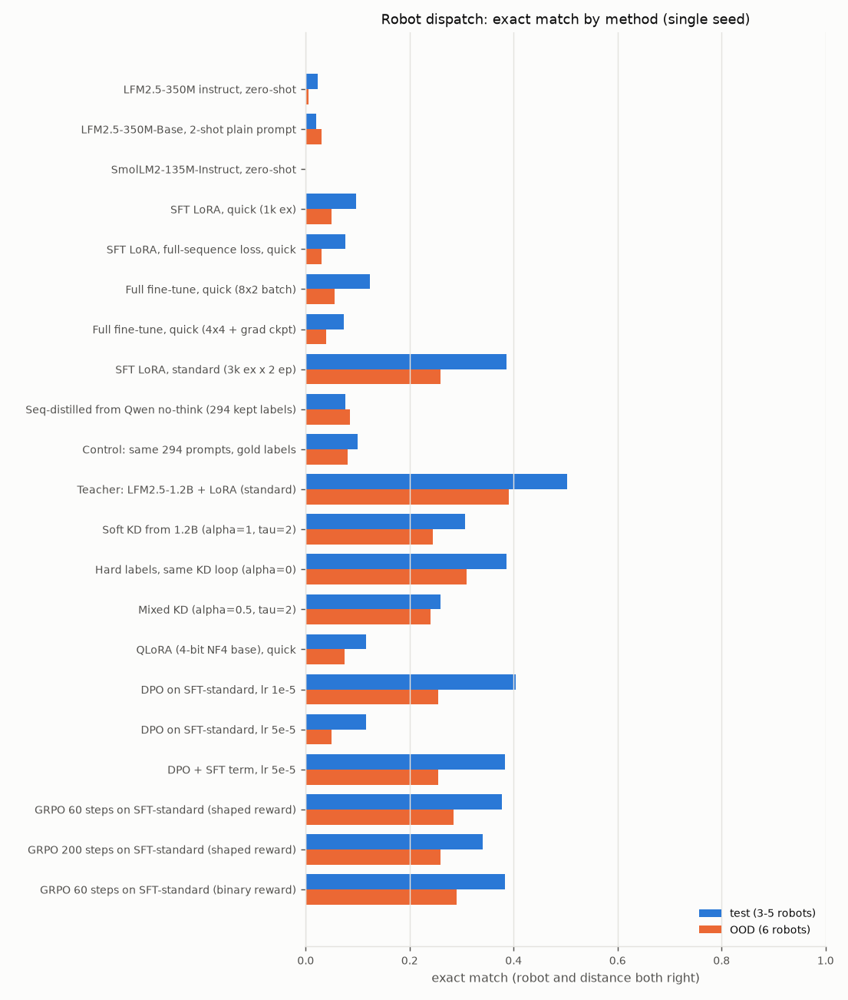
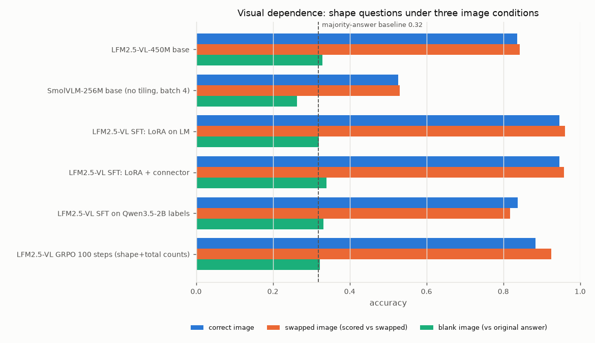

# LFM Learning Lab: language and vision-language models, hands-on, on one laptop GPU

A self-contained lab for learning how small language models (LMs) and vision-language
models (VLMs) work by **inspecting them, changing code, and running short, measured
experiments** on a single 8 GB laptop GPU (RTX 4060 Laptop). Everything here was executed on
that machine; every number in the lessons comes from a saved output file.

Primary models: [LiquidAI/LFM2.5-350M](https://huggingface.co/LiquidAI/LFM2.5-350M)
(hybrid convolution + attention LM) and
[LiquidAI/LFM2.5-VL-450M](https://huggingface.co/LiquidAI/LFM2.5-VL-450M). References:
LFM2.5-350M-Base, LFM2.5-1.2B-Instruct (teacher), SmolLM2-135M-Instruct, SmolVLM-256M-Instruct,
Qwen3.5-2B (teacher). Exact revisions: `configs/models.yaml`.

> This is a **learning lab**, not a benchmark or a research contribution. Runs are short and
> single-seed; their purpose is to make mechanics visible. Running the scripts is not the
> same as mastering the material. The exercises are where that happens.

## Learning path

Start with **[`lessons/00_START_HERE.md`](lessons/00_START_HERE.md)**, then:

| # | Lesson | What you will see |
|---|---|---|
| A | [Tokens, logits, generation](lessons/A_tokens_and_generation.md) | token IDs, chat template, masks, softmax/temperature, a hand-written greedy loop, the hybrid cache, BF16 vs FP32 cache equivalence |
| B1 | [LFM2.5 architecture](lessons/B1_lfm_architecture.md) | real module names and shapes, gated short convolutions vs GQA, parameter budget, why the cache is small |
| B2 | [Tiny Transformer from scratch](lessons/B2_tiny_transformer.md) | causal attention, shifted labels, cross-entropy, backprop, AdamW, overfitting (0.8M params, 15 s) |
| C | [SFT, LoRA, overfitting](lessons/C_sft_and_lora.md) | deterministic verifier, baselines, completion-only masking, LoRA math checked against gradients, full fine-tuning memory, memorisation |
| D | [Distillation](lessons/D_distillation.md) | sequence distillation with label-free filtering, soft-target KL distillation from a same-tokenizer 1.2B teacher |
| E | [DPO](lessons/E_dpo.md) | verifier-derived preference pairs, reference handling, a DPO collapse and its fix |
| F | [GRPO and best-of-n](lessons/F_grpo.md) | group-relative advantages as TRL 1.15 computes them, sparse rewards, sharpening vs exploration |
| V1 | [VLM architecture](lessons/V1_vlm_architecture.md) | pixels → patches → SigLIP2 → projector → image tokens; resolution/tiling/token-budget sweep |
| V2-V5 | [VLM fine-tuning, distillation, RL, visual dependence](lessons/V2_vlm_training.md) | scene-level splits, collator checks, connector training, multimodal GRPO, swapped/blank images |

Each lesson: concept → equations (every symbol defined) → tensors/shapes/code → runnable
experiment → **actual results** → exercise (`exercises/`) → separate solution (`solutions/`).
Also: [glossary](docs/GLOSSARY.md), [setup](docs/SETUP.md), [troubleshooting](docs/TROUBLESHOOTING.md),
[reproducibility](docs/REPRODUCIBILITY.md), [licensing](docs/LICENSING.md),
[extensions](docs/EXTENSIONS.md), [results tables](results/tables/), [progress log](PROGRESS.md).

## Quick start

```bash
git clone https://github.com/MahdiElzain/lfm-learning-lab && cd lfm-learning-lab
bash scripts/tools/install_env.sh        # isolated .venv, pinned packages (PyTorch 2.11.0+cu128, ...)
make verify                              # GPU, BF16, VRAM, disk
make download data test                  # models -> models/hf, datasets -> data/, verifier tests
make tokens                              # Lesson A
make sft PRESET=quick                    # LoRA SFT in ~40 s
```

Every training/eval script takes `--preset quick|standard|extended`, `--set key=value`
(change exactly one variable), and `--run-name`. Outputs land in
`outputs/runs/<experiment>/<run>/` (config, metrics, raw generations, adapter);
`make report` rebuilds `results/tables/*.md` and `results/plots/*.png`.

| Task | Command |
|---|---|
| Inference (text) | `make tokens` or `.venv/bin/python scripts/text/evaluate.py --name my_eval` |
| Inference (image + question) | `.venv/bin/python scripts/vlm/infer.py --image photo.jpg --question "What is here?"` |
| Datasets | `make data` |
| Training | `make sft`, `make sft-full`, `make overfit`, `make distill-seq`, `make dpo`, `make grpo`, `make vlm-sft` |
| Evaluation | `scripts/text/evaluate.py`, `scripts/text/41_best_of_n.py`, `scripts/vlm/evaluate.py` |
| Comparing experiments | `make report` → `results/tables/text_main.md`, `vlm_main.md`, `all_runs.md` |
| Saving / resuming | adapters saved automatically; `scripts/text/10_sft.py --run-name X --resume` |
| Whole VLM track | `bash scripts/tools/run_vlm_track.sh` |

## Main results (single seed, preliminary)

### Text: robot dispatch (pick the nearest *eligible* robot, report its distance as JSON)

300 test scenes (3-5 robots) and 200 out-of-distribution scenes (6 robots); greedy decoding.

| model / method | test exact | OOD exact | note |
|---|---|---|---|
| LFM2.5-350M instruct, zero-shot | 0.023 | 0.005 | valid JSON 100%, but 72% of answers violate a rule |
| LoRA SFT, 1k examples (39 s) | 0.097 | 0.050 | rule violations → ~0%; arithmetic still weak |
| LoRA SFT, 3k examples × 2 epochs (213 s) | 0.387 | 0.260 | starting point for DPO/GRPO |
| LFM2.5-1.2B + LoRA (teacher) | 0.503 | 0.390 | |
| soft-target KD 1.2B → 350M (α=1, τ=2) | 0.307 | 0.245 | best robot choice (82%), worse distances |
| same loop, hard labels | 0.387 | 0.310 | |
| DPO on SFT, lr 5e-5 | 0.117 | 0.050 | likelihood displacement; + SFT term fixes it (0.383) |
| GRPO on SFT, 200 steps | 0.340 | 0.260 | sharpened the policy: pass@8 0.75 → 0.54 |
| **SFT + best-of-8 with a label-free verifier** | **0.693** | | 8× tokens, 7× time, no training |

Full table: [`results/tables/text_main.md`](results/tables/text_main.md).



### Vision-language: synthetic shape scenes (counts, existence, left/right)

450 test questions on 150 held-out scenes (splits by scene); greedy; 64 image tokens per image.

| model / method | correct image | swapped image (scored vs swapped) | unchanged under swap | note |
|---|---|---|---|---|
| LFM2.5-VL-450M base | 0.836 | 0.843 | 0.33 | weakest at counting (total 0.67) |
| SmolVLM-256M base | 0.527 | 0.530 | 0.30 | smaller fallback reference |
| LoRA SFT on the language model (45 s) | **0.947** | 0.960 | 0.31 | vision tower frozen |
| LoRA + connector training | 0.947 | 0.958 | 0.31 | no gain from training the projector |
| SFT on Qwen3.5-2B labels | 0.838 | 0.818 | 0.37 | teacher (0.818) weaker than the student: mechanics only |
| GRPO, 100 steps, counting questions | 0.884 | 0.925 | 0.32 | blank-image ablation: reward 0.78 → 0.28 |

A model that ignored the image would keep ~100% of its answers under swapping; all of these
follow the image. Majority-answer baseline: 0.318. Full table and per-type accuracy:
[`results/tables/vlm_main.md`](results/tables/vlm_main.md).



## What did not work (and why that is useful)

* **Sequence distillation from Qwen3.5-2B (no thinking)**: the teacher scored 7.5%, far below
  our own SFT student (38.7%). A precise label-free filter kept only 9.8% of labels, biased
  towards easy scenes. Thinking mode reaches 87.5% but costs ~6 s per label.
* **Plain DPO**: no effect at lr 1e-5; at lr 5e-5 it lowered the likelihood of *chosen* answers
  and cut accuracy from 38.7% to 11.7%.
* **GRPO** did not improve greedy accuracy within 200 steps; it raised single-sample accuracy
  slightly while collapsing diversity.
* **Mixing hard labels into soft distillation (α = 0.5)** did not recover distance accuracy (0.260 exact).
* **Zero-shot tool calling** scored 0% on 40 scenes: well-formed calls, poor strategy, prose answers.
* **QLoRA** cut peak memory by ~70% at similar accuracy, but its adapter behaves differently on a BF16
  base (33/64 identical outputs): serve it on the base it was trained against.
* Two of my own bugs were caught by running things: a tiny-GPT initialisation that started at loss 82
  instead of ln V, and a RAG chunker that dropped wrapped lines (RAG 2/8 → 5/8 after the fix).

## Hardware and software (measured)

RTX 4060 Laptop GPU (8,188 MiB, compute capability 8.9), driver 580.178.04 (supports CUDA ≤ 13.0),
PyTorch 2.11.0+cu128 (CUDA runtime 12.8), Transformers 5.19.0, TRL 1.15.0, PEFT 0.21.2,
Datasets 5.1.0, Accelerate 1.15.0, bitsandbytes 0.50.2, Python 3.12.3, Ubuntu 24.04.4.
GPU and CPU were shared with a running ROS 2 / Gazebo simulation batch, so timings are indicative.

## Licensing

Code, configs, lessons and generated data: **Apache-2.0** (`LICENSE`). Model weights are **not**
redistributed here and keep their own licenses: LFM models use the **LFM Open License v1.0**
(commercial use limited above US$10M annual revenue); SmolLM2, SmolVLM and Qwen3.5 are Apache-2.0.
Adapters published from this lab are derivatives of LFM models and carry the LFM license.
See [`docs/LICENSING.md`](docs/LICENSING.md).
