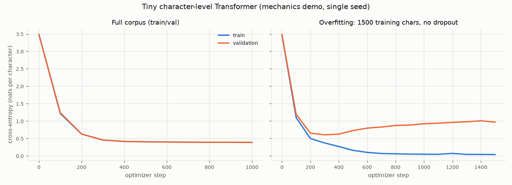

# Lesson B2: A tiny decoder-only Transformer from scratch

> **Mechanics demonstration, not competitive pretraining.** The model has
> about 0.8M parameters and trains for a minute on generated text. It exists
> so you can see every tensor that LFM2.5 (or any GPT-style model) also computes.

Code: `lab/tiny_gpt.py` (model) and `scripts/text/03_tiny_transformer.py` (training).

## 1. Concept and purpose

A decoder-only language model learns one thing: given tokens `x_1 … x_t`,
predict `x_{t+1}`. Everything else (chat, instruction following, JSON output)
is that same next-token prediction applied to different text. Building a tiny
one makes four ideas concrete: **causal attention**, **shifted labels**,
**cross-entropy training**, and **overfitting**.

## 2. Equations (every symbol defined)

Sizes: batch `B`, sequence length `T`, width `C`, heads `H`, head width
`D = C/H`, vocabulary `V`, layers `L`.

**Embedding.** Token IDs `x ∈ {0..V-1}^{B×T}` become vectors

```
h⁰ = E[x] + P[0..T-1]          E ∈ R^{V×C} (token table), P ∈ R^{T_max×C} (position table)
```

**Causal self-attention** (one head; `W_q, W_k, W_v ∈ R^{C×D}`):

```
Q = h W_q,  K = h W_k,  V = h W_v                      each (B, T, D)
S = Q Kᵀ / √D                                           (B, T, T) similarity scores
S[i, j] = -∞  for j > i                                 causal mask: no peeking at the future
A = softmax(S) along j                                  each row sums to 1
out = A V                                               (B, T, D)
```

`√D` keeps the scores' variance near 1 so the softmax does not saturate.
Heads are concatenated back to width `C` and mixed by `W_o ∈ R^{C×C}`.

**Block (pre-norm residual):**

```
h ← h + Attn(LN(h))
h ← h + MLP(LN(h))            MLP(u) = W₂ GELU(W₁ u),  W₁ ∈ R^{C×4C}, W₂ ∈ R^{4C×C}
```

`LN` is LayerNorm. The `h + …` residual paths let each block add a small
correction and let gradients flow straight back to early layers.

**Output head and loss.** `z = LN(h^L) Eᵀ` gives logits `z ∈ R^{B×T×V}`
(the head reuses `E`: weight tying). With targets `y_t = x_{t+1}` (shifted labels):

```
p_t = softmax(z_t)                                   probability over the vocabulary at position t
ℒ = -(1 / (B·T)) Σ_{b,t} log p_{b,t}[y_{b,t}]       next-token cross-entropy (nats)
perplexity = exp(ℒ)                                  "effective number of equally likely choices"
bits per character = ℒ / ln 2                        (this model's tokens ARE characters)
```

**Update (AdamW).** With gradient `g = ∂ℒ/∂θ`, AdamW keeps running averages
`m ← β₁m + (1-β₁)g`, `v ← β₂v + (1-β₂)g²` and steps
`θ ← θ - η( m̂/(√v̂ + ε) + λθ )` (`η` learning rate, `λ` weight decay,
hats = bias-corrected averages).

## 3. Tensors, shapes and code

| Math | Code (`lab/tiny_gpt.py`) | Shape |
|---|---|---|
| `x` | `idx` | `(B, T)` |
| `E[x] + P` | `tok_emb(idx) + pos_emb(pos)` | `(B, T, C)` |
| `Q, K, V` | `self.qkv(x).split(C, dim=2)` then `.view(B,T,H,D).transpose(1,2)` | `(B, H, T, D)` |
| `S` | `q @ k.transpose(-2,-1) / sqrt(D)` | `(B, H, T, T)` |
| mask | `masked_fill(self.mask[..., :T, :T] == 0, -inf)` | |
| `A V` | `attn @ v` | `(B, H, T, D)` |
| `z` | `lm_head(ln_f(x))` | `(B, T, V)` |
| `y = x` shifted | `get_batch`: `x = data[s:s+T]`, `y = data[s+1:s+T+1]` | `(B, T)` |
| `ℒ` | `F.cross_entropy(logits.view(B*T, V), targets.view(B*T))` | scalar |

## 4. Run it

```bash
.venv/bin/python scripts/text/03_tiny_transformer.py --preset quick
```

The script prints the shapes above for a real batch, the first rows of an
attention matrix (zeros above the diagonal = the causal mask), gradient norms
after the first backward pass, how much one AdamW step changed a weight, the
train/validation curve, a sample, a "distance probe", and then reruns the same
model on only 1,500 training characters to show overfitting.

## 5. Results and interpretation

Measured on this machine (`outputs/runs/tiny_transformer/quick/metrics.json`, quick preset, seed 0,
plot `results/plots/tiny_transformer_curves.png`). Corpus: 152,784 characters of generated robot logs,
vocabulary V = 40 characters, 90/10 train/validation split by position.



| Check | Result | What it shows |
|---|---|---|
| Parameters | 814,848 | C=128, H=4, L=4, T=128, tied embeddings |
| Shapes | x, y `[32, 128]`; logits `[32, 128, 40]`; attention `[32, 4, 128, 128]` | B, T, V, H as in the table above |
| Shifted labels | x = `'2_8 drives f'`, y = `'_8 drives fr'` | target = input moved one step left |
| Causal mask | row 2 of the attention matrix = `[0.335, 0.325, 0.341, 0, 0]` | zeros above the diagonal; near-uniform at initialisation |
| Initial loss | **3.750** vs ln V = 3.689 | an untrained model should be close to uniform guessing |
| Gradients | all parameters non-zero after the first backward pass | backpropagation reaches every layer |
| One AdamW step | ‖ΔW_qkv‖ = 0.0665 | the optimizer really moved the weights |
| Final validation loss | 0.388 nats/char = **0.56 bits/char** (perplexity 1.47) | train ≈ validation: no overfitting on 137k chars |
| Training time | 15.41 s for 1,000 steps | GPU shared with other jobs |
| Distance probe | **4%** of 200 greedy completions give the right distance | about chance (distances 0-18): the model learned the *format*, not the arithmetic |

**A bug this lesson caught.** The first run started at loss **82.5**, not ≈ 3.7.
PyTorch initialises `nn.Embedding` with N(0, 1); because the output head is tied
to the embedding, the initial logits had a standard deviation of about √128 ≈ 11,
so the model was confidently wrong about everything. Initialising with N(0, 0.02)
(as GPT-2 does) brought it to 3.75. Always compare the first loss with ln V.

**Overfitting.** The same model trained on only 1,500 characters with no dropout:
training loss falls to **0.040** while validation loss bottoms
out at **0.606 (step 300)** and then climbs to
**0.971**. Past step 300 every update makes the model
better at reproducing those 1,500 characters and worse at the rule. Early stopping
at the validation minimum, more data, or dropout are the standard remedies.


## 6. Perplexity across tokenizers: why you must not compare raw numbers

Perplexity is "per token". A character-level model predicts ~5× more tokens
for the same text than a word-piece model, and each character is easier to
guess than a whole word piece. So the char model's perplexity is far lower
*without being a better model*. Even two subword models with different
vocabularies (LFM2.5's 65,536 vs SmolLM2's 49,152) split text differently.
Fair comparisons convert to a tokenizer-independent unit:

```
bits per byte = (Σ over tokens of -log₂ p(token)) / (number of UTF-8 bytes of the text)
```

on the **same** evaluation text. Exercise B2.3 asks you to do this.

## 7. Exercise

See `exercises/B2_tiny_transformer.md`. Solutions: `solutions/B2_tiny_transformer.md`.
