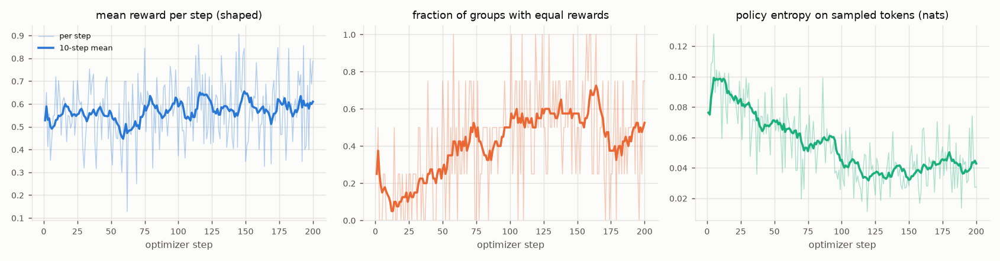

# Lesson F: Reinforcement learning with GRPO (and best-of-n as a baseline)

Code: `scripts/text/40_grpo.py`, `scripts/text/41_best_of_n.py`, `configs/grpo.yaml`.
Implementation: TRL **1.15.0** `GRPOTrainer` (`trl/trainer/grpo_trainer.py`).
The equations below were checked against that installed source, not a paper.

## 1. Concept and purpose

In SFT and DPO the training responses are fixed in advance. In **online RL**
the model writes its own responses during training and learns from how they
score.

* **Action**: one generated token. **State**: prompt plus tokens so far.
* **Trajectory (episode)**: the whole sampled completion.
* **Reward**: one number per completion from the verifier
  (`lab.robot_task.reward`): shaped `1.0 / 0.5 / 0.1 / 0.0` or binary `1/0`.
* **GRPO** samples a **group** of `G` completions for the same prompt and
  judges each one *relative to its siblings*. That removes the need for a learned
  value function (PPO's "critic").

We start from the SFT model (merged weights + a fresh LoRA), because a policy
that never produces a correct answer gets no useful signal.

## 2. Equations: exactly what TRL 1.15 computes

For one prompt `x`, sample `o_1..o_G ~ π_old(·|x)` with temperature `T` and
score them `r_1..r_G`.

**Group-relative advantage** (`scale_rewards="group"`, the default):

```
μ = (1/G) Σ_i r_i
s = sqrt( (1/(G-1)) Σ_i (r_i - μ)² )          Bessel-corrected sample std (trl.trainer.utils.nanstd)
Â_i = (r_i - μ) / (s + 1e-4)                   same value for every token t of completion i
```

If all `G` rewards are equal, `Â_i = 0` for the whole group: **no gradient**.
TRL logs the fraction of such groups as `frac_reward_zero_std`.

**Per-token ratio and clipped surrogate** (token-level importance sampling):

```
ρ_{i,t} = exp( log π_θ(o_{i,t} | x, o_{i,<t}) - log π_old(o_{i,t} | x, o_{i,<t}) )
ℓ_{i,t} = - min( ρ_{i,t} Â_i ,  clip(ρ_{i,t}, 1-ε, 1+ε) Â_i )  +  β · KL_{i,t}
KL_{i,t} = exp(q) - q - 1,    q = log π_ref(o_{i,t}|…) - log π_θ(o_{i,t}|…)      ("k3" estimator; only if β > 0)
```

**Aggregation**, `loss_type="dapo"` (the TRL 1.15 default): sum the token
losses of *all* completions in the generation batch and divide by the *total*
number of completion tokens:

```
ℒ = Σ_i Σ_t ℓ_{i,t} / Σ_i |o_i|
```

(The original GRPO paper averages per sequence first, `"grpo"`; `"dr_grpo"`
divides by a constant `G · max_completion_length`.)

**Important detail with the defaults** (`num_iterations = μ = 1`): each batch of
samples is used for one gradient step, so TRL sets `π_old = π_θ.detach()`.
Numerically `ρ = 1` and the clip never activates. The gradient is still the
policy gradient, because `∇ρ = ∇ log π_θ`:

```
∇ℒ = - Σ_{i,t} Â_i ∇ log π_θ(o_{i,t}|…) / Σ|o_i|        (REINFORCE with a group baseline)
```

Clipping only matters when `num_iterations > 1` (several steps on the same samples).

**Batch geometry** (checked by the script and by TRL):

```
completions per optimizer step = per_device_train_batch_size × gradient_accumulation_steps   (one GPU)
this number must be divisible by G;   prompts per step = that number / G
```

Our quick config: 16 × 2 = 32 completions = 4 prompts × G=8.

## 3. PPO and learned reward models (conceptual)

* **PPO** uses the same clipped ratio but replaces the group baseline with a
  learned **value function** `V(s)` and per-token advantages from
  generalised advantage estimation. That needs a second network (often as big
  as the policy) and more tuning; GRPO's group mean is a cheap Monte-Carlo
  baseline instead.
* **Learned reward models** score text with a network trained on human
  preference pairs (a Bradley-Terry loss like DPO's). They are needed when no
  verifier exists, and they can be *hacked*: the policy finds text the reward
  model likes that humans would not. With a deterministic verifier we avoid that
  failure, but **reward design can still be exploited**: e.g. the shaped
  reward's 0.1 for "any eligible robot" could become a local optimum.

## 4. What to inspect during a run

| Symptom | Where to look | Meaning |
|---|---|---|
| `frac_reward_zero_std` near 1 | `train_log.jsonl` | every group all-right or all-wrong: no signal (sparse reward) |
| all completions identical | `groups.unique_completions_per_group_*` in `metrics.json` | output collapse (no exploration) |
| reward rises, test accuracy does not | compare `reward` with eval | reward exploitation or overfitting to train prompts |
| `nan` loss / exploding grad norm | `train_log.jsonl` | numerical instability; lower LR, check bf16 |
| completions hit `max_completion_length` | `completions/clipped_ratio` | truncation; answers never finish |

## 5. Best-of-n: the inference-time alternative

Instead of training, sample `k` answers and select one with a checker. With a
**label-free** checker (parses, eligible robot, self-consistent distance) and
majority vote, this is deployable. **Oracle pass@k** (any sample exactly right)
needs gold labels and is only an upper bound. Cost grows ~k× per request,
forever; GRPO pays once at training time.

## 6. Run it

```bash
make grpo SFT=outputs/runs/text_sft/lora_quick/adapter
make bon  SFT=outputs/runs/text_sft/lora_quick/adapter
.venv/bin/python scripts/text/40_grpo.py --set reward_mode=binary --run-name grpo_binary \
    --set sft_adapter=outputs/runs/text_sft/lora_quick/adapter
```

## 7. Results and interpretation

All runs start from the merged SFT-standard model (Lesson C: 38.7% exact) and use fresh
prompts (train rows 3000+). Files: `outputs/runs/text_grpo/*`, `outputs/evals/*best_of_8*`.
Plots: `results/plots/text_grpo_shaped.png` (200 steps), `results/plots/text_grpo_binary.png`. Single seed.



| run | steps × prompts × G | train s | peak alloc GB | test exact | distance | OOD exact | equal-reward groups (mean) | all-zero groups |
|---|---|---|---|---|---|---|---|---|
| SFT standard (start) | | | | 0.387 | 0.440 | 0.260 | | |
| GRPO shaped, quick | 60 × 4 × 8 | 94.4 | 4.889 | 0.377 | 0.407 | 0.285 | 0.246 | 0.000 |
| GRPO shaped, standard | 200 × 4 × 8 | 305.3 | 4.889 | 0.340 | 0.357 | 0.260 | 0.419 | 0.003 |
| GRPO **binary**, quick | 60 × 4 × 8 | 92.8 | 4.889 | 0.383 | 0.427 | 0.290 | 0.354 | 0.321 |

**Checks against the implementation.** Batch geometry 16 × 2 = 32 completions = 4 prompts × G = 8
(divisible, as required). `clip_ratio/*` was exactly 0 at every step: with `num_iterations = 1`
the importance ratio is 1, so clipping never fires, as derived in section 2. Completion lengths
stayed at 17-18 tokens (no truncation: `clipped_ratio` 0).

**What happened during 200 steps** (training samples at T = 1):

* mean reward rose only slightly (≈0.55 → ≈0.59; the share of full-credit samples 30% → 37%);
* policy entropy halved (0.09 → 0.04 nats): the policy became more deterministic;
* the fraction of **equal-reward groups grew from ~12% to ~50%**: half the groups end up
  giving no gradient at all. The last ten logged groups had only 1-2 distinct completions out of 8;
* a typical early group: all 8 samples pick the same robot and vary only the distance
  (`9, 10, 12, 10, 10, …`); only the correct digit gets reward 1.0, the rest 0.5.

**Greedy test accuracy did not improve** (38.7% → 37.7% after 60 steps, 34.0% after 200;
OOD 26.0% → 28.5% → 26.0%). The 200-step drop is close to the noise level of one seed
on 300 scenes (one standard error ≈ 2.8 points per number), so the honest conclusion is
"no gain, possibly a small loss", not "GRPO hurts".

**Why: sharpening versus exploration.** Multiple-sample evaluation explains it
(300 test scenes, k = 8, T = 1):

| model | greedy | mean single sample | first label-free-valid | majority of label-free-valid | oracle pass@8 | tokens / time vs greedy |
|---|---|---|---|---|---|---|
| SFT standard | 0.387 | 0.295 | 0.677 | **0.693** | 0.750 | 8.0× / 7.0× |
| SFT + GRPO (200 steps) | 0.340 | 0.311 | 0.520 | 0.520 | 0.537 | 8.0× / 6.9× |

GRPO raised the accuracy of a *single sample* slightly (29.5% → 31.1%), which is what its
objective rewards, but it did so by **concentrating probability** on fewer answers. The
eight samples became less diverse, so pass@8 fell from 75% to 54%. This is the classic RL
trade-off: sharpening improves pass@1 of samples and costs pass@k.

**The cheapest big win was inference-time selection.** Sampling 8 answers from the SFT
model and keeping the most common one that passes the *label-free* check raised accuracy
from 38.7% to **69.3%**, with no training, at 8× the generated tokens and 7× the time per
request. It works because most remaining errors are arithmetic, and the self-consistency
check ("the reported distance equals the chosen robot's true distance") catches exactly
those. Oracle pass@8 (75%) needs gold labels and is only an upper bound.

**Sparse reward.** With the binary reward, 35% of groups had equal rewards on average and
**32% had no correct sample at all** (vs 0% all-zero with the shaped reward, whose 0.5/0.1
partial credit separates "right robot" from "wrong robot"). Those groups contribute zero
gradient. Test accuracy after 60 steps matched SFT (38.3%).

**Reward-exploitation audit (shaped reward).** The 0.1 reward ("eligible robot, wrong
answer") is the loophole to watch. Its share among training samples went 22% → 26% →
18% → 24% over the four quarters of the 200-step run: no sustained drift, so no evidence of
exploitation in this budget. Exercise F.4 asks you to look for it in longer runs.

**Cost comparison.** GRPO (200 steps) cost 305 s of training once; best-of-8 costs ~7×
inference time on every request. For a robot that dispatches thousands of tasks, training
is cheaper *if* it reached the same accuracy, but here it did not.


## 8. Exercise

See `exercises/F_grpo.md`. Solutions: `solutions/F_grpo.md`.
